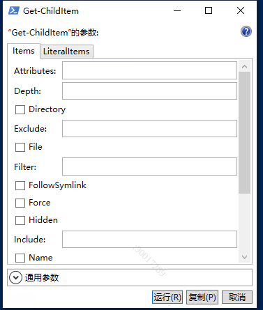

# Windows PowerShell
PowerShell 是一种自动化解决方案，由命令行 shell、脚本语言和配置管理框架组成。

## 命令行
Windows PowerShell 取代了 Windows 命令行接口 (cmd.exe) 及其批处理文件脚本语言的有限功能。 PowerShell 接受并返回 .NET 对象，其中包括：
- 命令行历史记录。
- Tab 自动补全和预测。
- 支持命令和参数别名。
- 链接使用管道功能的命令。
- 可靠的控制台内帮助系统

> [!NOTE]
> `Windows Powershell`只能在`Windows`操作系统内运行，而`Powershell`可以在`MacOs`、`Linux`、`Windows`不同平台运行，`Powershell`使用 .NET Core 实现。

## 脚本语言
`Windows Powershell`脚本简单来说，就是和`Linux`类似，由不同的`Powrshell`命令组成。

## 配置管理框架
PowerShell 中的配置管理框架主要指 DSC（Desired State Configuration，期望状态配置），这是微软官方的声明式配置管理平台。

### 核心概念
声明式 vs 命令式：
- 命令式: 告诉系统怎么做(一步一步执行命令)。
- 声明式（DSC）：告诉系统"要什么状态"，系统自动判断并达成。

## 执行策略
PowerShell 中的执行策略，用于控制 PowerShell 加载配置文件和运行脚本的条件。 此功能有助于防止恶意脚本的执行。

> [!TIP]
> 用户无法执行脚本，但可以通过在命令行中输入脚本内容来绕开策略。

### 作用域（Scope）
|作用域|说明|
|------|----|
|`MachinePolicy`|	通过组策略（GPO）为计算机所有用户设置|
|`UserPolicy`|	通过组策略（GPO）为当前用户设置|
|`Process`|	仅对当前 PowerShell 会话进程有效（保存在环境变量 $env:PSExecutionPolicyPreference 中，关闭窗口即失效）|
|`CurrentUser`|	仅对当前登录用户有效（修改无需管理员权限）|
|`LocalMachine`|	对本机所有用户有效（Set-ExecutionPolicy 的默认作用域，修改需要管理员权限）|

### 常见执行策略
|策略|	说明|
|----|------|
|`Restricted`	|默认策略，不允许运行任何脚本（Windows 客户端）
|`AllSigned`	|只能运行由可信发布者签名的脚本
|`RemoteSigned`|	本地脚本可运行，下载的脚本需要签名（推荐）
|`Unrestricted`|	允许运行所有脚本（会有警告）|
|`Bypass`	|不阻止任何脚本，无警告|
|`Default（默认）`|	最常用的开发配置|
|`Undefined`|表示当前作用域（Scope）没有设置执行策略，如果所有作用域均为 Undefined，则 Windows 客户端实际生效的策略为 Restricted，Windows Server 为 RemoteSigned|

- 查看当前作用域的执行策略：
```Powershell
Get-ExecutionPolicy
```

- 查看所有作用域的执行策略：
```Powershell
Get-ExecutionPolicy -List
```

- 设置执行策略:
```Powershell
Set-ExecutionPolicy -ExecutionPolicy <PolicyName>
```

## 语法
`Powershell`的命令语法结构结组成："动词+名词"。如: `Get-NetTCPIP`：**Get**为动词，**NetIPaddress**为名词。名词部分指示该 cmdlet 影响的资源或对象的类型。如`Service`是 windows 服务，`Process`是 windows 进程。

### 参数格式
参数修改 cmdlet 执行的操作。 可不为 cmdlet 指定参数或为其指定一个参数或多个参数。

参数名称以短划线 (-) 开头。 空格用于分隔要从参数名称传递的值。 如果传递的值包含空格，需要用引号将文本引起来。 某些参数接受多个值，这些值必须用逗号分隔（不含空格）。

### Tab补全
这个功能就类似`Linux`操作系统的补全功能了。输入 cmdlet 或参数的几个字符，然后按 Tab 键。 PowerShell 根据输入的内容自动提供缺少的名称部分。

Tab 自动补全甚至可以使用通配符。 如果知道某个 cmdlet 在服务上运行，但不确定需要哪个 cmdlet，在控制台中输入文本 *-service ，然后按 Tab 键查看名称中包含文本 -service 的所有 cmdlet。

## 帮助主题
主题：是 PowerShell 的概念文档，解释核心概念、设计理念和最佳实践，而不是具体命令的用法，与 `Get-Help <命令>` 的区别：后者告诉你"怎么用这个命令"，而 `about_*` 告诉你"这个功能背后的原理"

- 查看完整的帮助主题:
```Powershell
Get-Help about*
```

- 查看某个帮助主题，如有关cmdlet参数的主题:
```Powershell
Get-Help about_CommonParameters
```

- 联机查看主题：
```Powershell
Get-Help about_CommonParameters -Online
```

- 新窗口中查看主题：
```Powershell
Get-Help about_CommonParameters -ShowWindow
```

## Get-Command 和 Get-Help
cmdlet 太多肯定无法记住所有命令，`Powershell`内置了查找帮助相关的命令来辅助该如何使用这些`cmdlet`。

### 模块
模块是一组相关的 PowerShell 功能，它们被捆绑在一起形成一个单元。可以将它们视为托管多个 cmdlet 的容器。 模块有助于将 cmdlet 组织到可分发单元中。

- 检索当前可用的模块:
```Powershell
Get-Module -ListAvailable
```
- 加载模块:
```Powershell
Import-Module <模块名>
```

> [!NOTE]
> Windows PowerShell 版本 3.0 及更新版本中，如果运行属于该模块的 cmdlet，模块会自动加载。
> 查看加载模块的路径：`echo $$env:PSModulePath`

### Get-Command
Get-Command 检索单个命令或多个命令的相关信息，例如名称、类别、版本，甚至它所属的模块。

- 检索单个命令：
```Powershell
Get-Command Get-ChildItem
```
- 通配符检索：
```Powershell
Get-Command *enent*
```
- 通过名词(`Noun`)筛选出动词(`Verb`)Get的命令:
```Powershell
Get-Command -Noun *event* -Verb Get
```
- 通过模块名包仿的命令列表:
```Powershell
 Get-Command -Module ProcessMitigations
```

> [!TIP]
> 模块名可以通过`Get-Module -ListAvailable`获取。

### Get-Help
使用 Get-Help 和 Get-Command 不同的是，如果 Get-Help 找不到匹配的命令名称，它会使用查询字符串执行全文搜索。 如果运行 Get-Command \*beep\* 命令，则不会获得任何结果。 如果运行 Get-Help \*beep\* 命令，它将返回多个结果。

## Show-Command
Show-Command cmdlet 打开一个窗口，其中显示命令列表或特定命令的参数。



## Windows PowerShell 管道
`PowerShell`管道概念类似于`Linux`，上个命令的输出通过管道传给下一个命令，管道符用`|`表示。和`Linux`管道概念区别的是`Linux`传递的是文本字符，而`Windows Powershell`传递的是一个对象。

> [!NOTE]
> 对象是内存中结构化并且有属性的，无需解析，可以通过属性直接过滤。

### 对象成员
成员是组成对象的集合，包括：
- 属性，描述对象的特性。 属性的示例包括服务名、进程 ID 号和事件日志消息。
- 方法，用于对对象调用操作。 例如，可以停止进程对象，并且可以清除事件日志。
- 事件，在对象发生某些情况时触发。 文件在更新时可能会触发事件，或者进程在有输出要生成时可能会触发事件。

