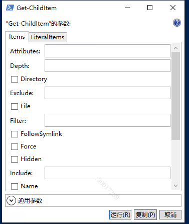

# WindowsPowerShell
`windows Powershell` 是一种类似于 `Linux shell` 的命令行工具，用于自动执行基于 `Windows` 的系统的管理任务。 `Windows PowerShell` 预安装在 `Windows` 操作系统的所有新式版本上。

## PowerShell cmdlet 的结构
PowerShell cmdlet 使用的常见格式是“动词-名词”表示法。

### Cmdlet 动词
cmdlet 名称的谓词部分指示该 cmdlet 执行的操作。常见谓词包括：
- Get: 检索资源，例如文件或用户。
- Set: 更改与资源相关的数据，例如文件或用户属性。
- New: 创建资源，例如文件或用户。
- Add: 将资源添加到多个资源的容器。
- Remove: 将资源从多个资源的容器中删除。

> [!TIP]
> 可以运行 Get-Verb 该命令，获取谓词的完整列表。

### Cmdlet 名词
cmdlet 名称的名词部分指示该 cmdlet 影响的资源或对象的类型。对同一资源运行的所有 cmdlet 应使用相同的名词。 例如，Service 名词适用于使用 Windows 服务的 cmdlet，而 Process 名词用于管理计算机上的进程。

名词中还可以包含前缀，可帮助将相关名词按系列分组。 例如，Active Directory名词以字母 AD开头（如 ADUser、ADGroup 和 ADComputer）。 Microsoft SharePoint 服务器 cmdlet 以前缀 SP 开头，Microsoft Azure cmdlet 以前缀 Az 开头。

### 参数
参数名称以短划线 (-) 开头。 空格用于分隔要从参数名称传递的值。 如果传递的值包含空格，需要用引号将文本引起来。 某些参数接受多个值，这些值必须用逗号分隔（不含空格）。

#### 可选参数与必需参数
参数可以为可选参数或必需参数。 如果是必需参数，而运行 cmdlet 时没有提供该参数的值，Windows PowerShell 会提示你为其提供值。

在某些情况下，可选择不输入参数名称，只需输入参数的值即可。 运行命令 Get-ChildItem C:\ 与运行命令 Get-ChildItem -Path C:\ 相同，因为参数 -Path 在 cmdlet 定义中定义为第一个参数。 这称为位置参数。 

#### 布尔值
某些参数接受类似`true`或`false`的布尔值，与实际布尔值不同的是，当命令包含了该开关参数，才会相当于显示指定了`True`,否则就是`False`，一个示例是 Get-ChildItem cmdlet 的 -Recurse 参数或开关。 Get-ChildItem c:\ -Recurse 命令不仅会返回 C:\ 目录中的项，还会返回其所有子目录中的项。 如果没有 -Recurse 开关，将仅返回 C:\ 目录中的项。

### Tab 补全功能
Windows Powershell有类似于Linux的Tab补全命令行功能，只需要给出模糊前几个字符按下Tab键就可以显示更多可用选项，如果知道需要适用于Active Directory资源，则可以在控制台中输入文本 `Get-AD`，然后按 Tab 键查看可用选项。
对于参数，只需输入短划线 (-)，然后可以多次按 Tab 键查看 cmdlet 的所有参数。

Tab 自动补全甚至可以使用通配符。 如果你知道某个 cmdlet 在服务上运行，但不确定需要哪个 cmdlet，请在控制台中输入文本 *-service ，然后按 Tab 键查看名称中包含文本 -service 的所有 cmdlet。

### 帮助主题
虽然 Windows PowerShell 中的很多帮助内容与命令有关，但也有很多帮助文件描述了 PowerShell 概念。 这些文件包括有关 PowerShell 脚本语言、运算符和其他详细信息的信息。 此信息并不具体涉及单个命令，而是涉及全局 shell 技术和功能。

- 可以通过运行以下命令来查看这些主题的完整列表：
```Powershell
Get-Help about*
```

- 查看指定主题：
```Powershell
Get-Help about_CommonParameters
```

- 还可以在单独的窗口中或联机打开帮助主题：
```Powershell
Get-Help about_CommonParameters -ShowWindow
Get-Help about_CommonParameters -Online
```

## 查找命令和 Get-Help
有时 Cmdlet 太多，无法记住所有的名称。得通过帮助来查找命令行和参数。

### 模块
模块是一组相关的 PowerShell 功能，它们被捆绑在一起形成一个单元。要使用这些模块功能，必须将该模块加载到当前的 PowerShell 会话中。

在 Windows PowerShell 版本 3.0 及更新版本中，如果运行属于该模块的 cmdlet，模块会自动加载。

模块文件路径：

- `%systemdir%\WindowsPowerShell\v1.0\Modules`

- `%userprofiles%\Documents\WindowsPowerShell\Modules`

对于 PowerShell 7，PSModulePath 包含以下位置：

- C:\Users\<user>\Documents\PowerShell\Modules
- C:\Program Files\PowerShell\Modules
- C:\Program Files\PowerShell\7\Modules
- C:\Program Files\WindowsPowerShell\Modules
- C:\WINDOWS\System32\WindowsPowerShell\v1.0\Modules

- 检查可用模块的列表：
```Powershell
Get-Module -ListAvailable
```

- 加载模块:
```Powershell
# WindowsUpdate 是模块名
Import-Module WindowsUpdate
```

### 命令别名
传统的`CMD`命令，多数情况下在`PowerShell`下可以继续使用，如：

|CMD|功能|等效于`PowerShell`|
|---|----|------------------|
|dir|列出目录|`Get-ChildItem`|
|cd|切换目录|`Set-Location`|
|mkdir|创建新目录|`New-Item`|

> [!TIP]
> `CMD`别名通常不支持原始命令使用的参数。

### Get-Alias
`Get-Alias`可以列出`PowerShell`内置和新定义的别名。

- 不带参数的 Get-Alias 返回所有已定义的别名。

- 特定别名使用`-Name`参数：
```Powershell
Get-Alias -Name cd
```

- 获取 cmdlet 的别名:
```Powershell
Get-Alias -Definition Get-ChildItem
```

### New-Alias
使用 New-Alias cmdlet 创建自定义别名，并将其映射到任何现有 cmdlet。自定义别名不会在 Windows PowerShell 会话之间保存。 每次打开 Windows PowerShell 时，都可以使用 Windows PowerShell 配置文件重新创建别名。

- 创建`Get-ChildItem`的别名:
```Powershell
New-Alias -Name "List" Get-ChildItem
```
### Show-Command
Show-Command cmdlet 将打开一个窗口，其中显示命令列表或特定命令的参数。
```Powershell
Show-Command -Name Get-ChildItem
```
